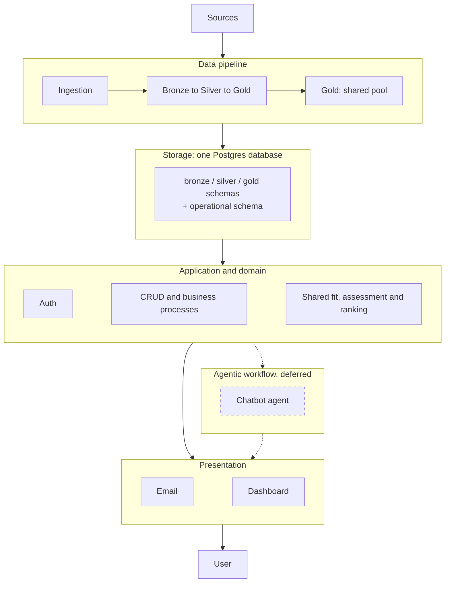
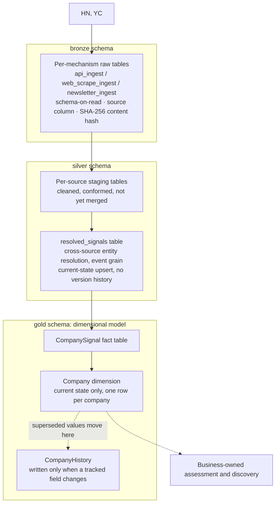
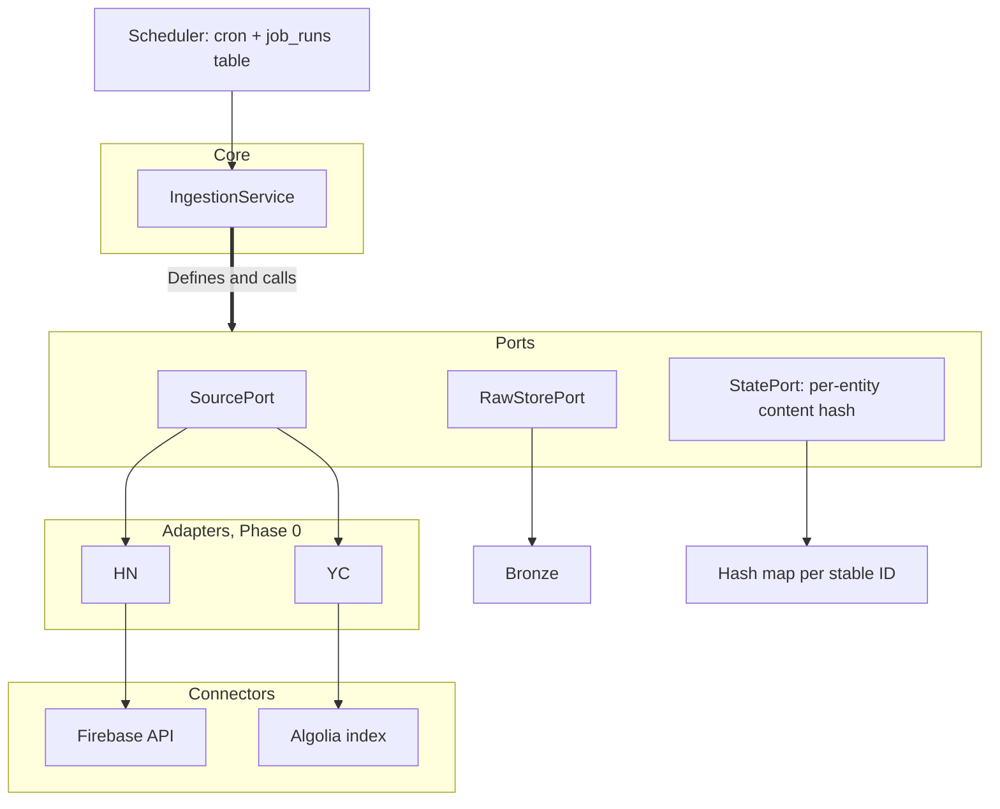
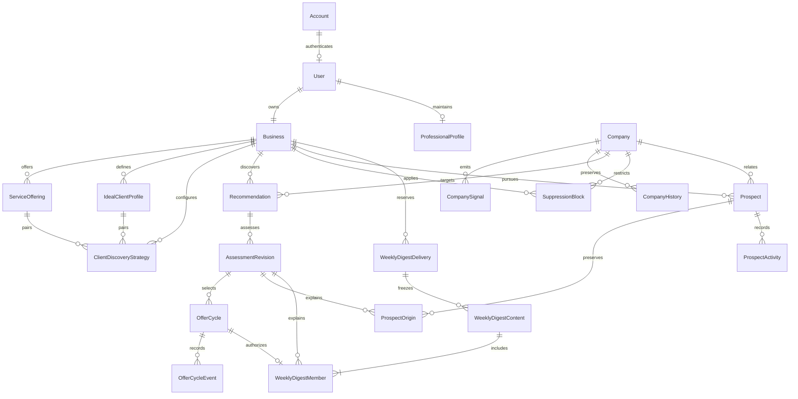

Status: DRAFT, partially implemented. Ingestion and the Bronze write path are built for HN, YC, OpenCorporates, and EU-Startups. Silver and Gold are wired end to end for HN, YC, and EU-Startups via `python -m huginn.elt`; OpenCorporates reaches Bronze but is not yet wired into Silver/Gold. Business-owned recommendations now share immutable assessments and offer cycles across the authenticated workspace and opt-in weekly SMTP delivery. Explicit Save creates a prospect relationship with retained origins and activity history. The creation-only Match writer and its admission/worker paths are retired. This describes source implementation, not deployment activation. Architecture decided across a series of design sessions, September 2026.
Author: Khaled Awashreh

Supersedes [Huginn Diagrams](https://kawashreh.atlassian.net/wiki/spaces/Huginn/pages/950273/Huginn+Diagrams) v1.3 wherever its "Not yet specified" table has since been resolved below. Its diagrams are the historical source for this document's graphs. This document is the authoritative, current-state architecture.

Companion documents: [Huginn Concept Doc](https://kawashreh.atlassian.net/wiki/spaces/Huginn/pages/917506/Huginn+Concept+Doc) (v1.3, product vision, on Confluence), `docs/entities.md` (domain schema, in progress), `architecture-notes/` (supporting research), `adr/` (decision records), Jira epic KAN-16 (tracked tech debt and research debt). Full list in section 13.

Architecture at a glance:

1. Storage: one Postgres database. Three ELT schemas (bronze, silver, gold) feed a separate operational schema.
2. Ingestion: ports and adapters, three sources at launch, HN "Who's Hiring", the YC directory, and OpenCorporates.
3. Entity resolution: runs at silver, domain-key first, Jaro-Winkler/token-Jaccard fallback.
4. Discovery: management orchestrates Business-owned recommendation generation over guarded source evidence using shared matchmaking assessment policies. App and weekly email select the same stable identities and immutable revisions (section 7).
5. Delivery: a weekly email digest is the product direction; opt-in weekly composition and SMTP delivery are implemented by an explicit scheduled command.
6. Presentation: the authenticated workspace supports recommendations, prospects and Profile configuration. Chat-based profile building, outreach automation and memory remain outside this workflow.

---

## 1. Problem and vision

1. Prospecting is the hardest part of running a solo services business, and often what stops people going independent at all: with no sales team it competes directly with billable work.
2. Startups are the high-fit case and the hard case at once. They lack the org charts, headcount plans, and formal recruiting processes that make bigger companies legible from outside, so the gap is visibility rather than fit, and the signal (funding, hiring, program milestones) is scattered and easy to miss on top of client work.
3. The answer is a Monday-morning email: a shortlist rather than a feed, pre-checked against criteria the user set, each entry carrying who the company is, why it surfaced, and a drafted outreach opener, learning over time what a "yes" and a "no" look like for this user.

Full problem statement and vision: [Huginn Concept Doc](https://kawashreh.atlassian.net/wiki/spaces/Huginn/pages/917506/Huginn+Concept+Doc) sections 1 and 2.

## 2. Goals and non-goals

Goals for this phase:

1. A weekly digest: a ranked shortlist of companies matching a plain-language ICP.
2. Per company: name, site, a LinkedIn search link (not scraped data), a short description, plain-language match reasoning, and a drafted outreach opener.
3. A domain model that's multi-user from day one, even though exactly one user exists right now. Phase 2 becomes additive, not a rebuild.
4. Ingestion from three sources: HN "Who's Hiring", the YC directory, and OpenCorporates.

Non-goals for this phase:

1. No CRM or outreach automation. The opener is a draft to edit and send, not something the system sends on its own.
2. No chatbot UI and no conversational ICP refinement. ICP capture is a one-time plain-text-to-structured-filter form.
3. No scraped LinkedIn profile data. Search-link only. `hiQ v. LinkedIn` is the standing reason, and the same caution extends to person-level scraping generally (section 6).
4. No real-time alerts. Weekly batch by design.
5. No graph-traversal or ML model predicting a company's current needs. Team-composition signal, where it exists at all, is a hand-authored heuristic drawn only from company-owned pages and press releases.
6. No scoring or ranking in the current matching slice (section 7).
7. No public registration, role-based access control, or billing. KAN-71 only
   establishes the Account/User/Profile storage and management runtime. KAN-72
   adds owner-only atomic provisioning and password hashing; KAN-73 adds login,
   server-side sessions, and ownership enforcement.

## 3. System overview

Five layers. The data pipeline feeds storage. Everything above it reads from storage.

Collection and the Gold pool are shared infrastructure. Discovery assessments, suppression and pursuit belong to the owning Business. Generation and delivery have distinct clocks and transaction boundaries.

Management is a separate application boundary, not a second production data
domain. Production retains the shared Postgres model shown above. Local
development uses `HUGINN_MANAGEMENT_DATABASE_URL` with a dedicated disposable
database so management bootstrap work does not disturb concurrent ELT work;
that database receives the schema prerequisites because operational foreign
keys reference Gold. Current workflow setup and readiness are described in the cutover guide.

Assessment and ranking decisions belong in pure policy modules. Application services orchestrate them through ports and preserve explainable snapshots for workspace and email presentation.

## 4. Data pipeline: bronze, silver, gold

One Postgres database carries three schemas, `bronze`, `silver`, and `gold`, alongside the operational schema described in section 9. No separate lake or warehouse: unjustified overhead at two sources and low request volume, and nothing here forecloses moving to one later if volume justifies it.

The generic medallion, schema-on-read, dimensional-modelling, and SCD patterns behind these layers are not restated here. The primary sources are collected in `architecture-notes/industry-references-elt-medallion.md`. What follows is only where Huginn makes a choice.

ELT code separates responsibilities within its owning Bronze, Silver or Gold
area. Values live in `models/`, pure parsing in `normalizers/`, decisions in
`policies/`, database adapters in `repositories/`, repository contracts in
`repositories/protocols/`, orchestration in `services/`, and commands and
serialization in `presentation/`. Services depend on contracts; entry points
compose concrete adapters. Silver filesystem reporting implements a writer
Protocol, and pure parsing/policy imports must not transitively load network or
database clients. Tests mirror these roles. Source context, currentness and
attribute assessment are responsibilities spread across these areas, not flat
packages containing an entire effort. See `AGENTS.md` for the review rules.

### 4.1 Bronze

1. Tables group by ingestion mechanism, not by source: `bronze.api_ingest`, `bronze.web_scrape_ingest`, `bronze.newsletter_ingest`. HN and YC are both `api` today. The candidate sources in [Huginn Concept Doc](https://kawashreh.atlassian.net/wiki/spaces/Huginn/pages/917506/Huginn+Concept+Doc) section 7 map to `web_scrape` (VC boards, Ramp, Harmonic) or `newsletter` (the four Substack feeds) when added.
2. Columns: `payload` (close to as-fetched, with documented adapter-level privacy filtering and no other field mapping or cleaning), `source` (`hn`, `yc`, and so on), fetch timestamp, run ID, `last_checked_at`. For example, the OpenCorporates adapter removes its potentially personal `officers` field before creating a `RawRecord` for Bronze persistence.
3. Watermarking is by content hash, because neither HN's Firebase API nor YC's Algolia backend offers a reliable changed-only cursor. A SHA-256 over a deliberately chosen, lightly normalized subset of each source's fields gives `(source, stable_id, content_hash)` where a native `updated_at` would sit. The `source` qualifier keeps two sources' native IDs from colliding in a shared table.
4. A fetch whose hash already exists writes nothing and bumps `last_checked_at` instead, which tells a healthy-but-static source apart from a job that has silently stopped running. A fetch whose hash differs overwrites the existing row in place: `UNIQUE (source, stable_id)` allows exactly one row per entity, so Bronze holds only the latest raw payload per entity, not every prior version.

### 4.2 Silver

1. Per-source staging tables, each conformed to a common shape but not merged across sources (ADR-0001), so HN's cleaning logic and YC's stay independently inspectable.
2. One cross-source `resolved_signals` table then runs entity resolution (section 6) at event grain, one row per original signal, raw company name replaced by a resolved canonical identifier.
3. No dimension/fact split at this layer. That is Gold's job, per Databricks and Kimball.
4. The source-specific staging and resolved-signal tables remain current-state upserts. Bronze also holds only the latest raw payload per entity (section 4.1 point 4).
5. `silver.source_context_snapshot` is a narrow exception: an explicit preservation command stores versioned, source-keyed text and fields before further projection. Its run and outcome tables record exclusions and observations independently of company identity. This sidecar does not change staging, resolution, Gold, or discovery eligibility. It cannot recover raw versions that Bronze already overwrote. See [source-context.md](source-context.md).
6. `silver.source_lifecycle_observation` and `silver.source_currentness` extend that sidecar with immutable source lifecycle/identity observations and one current pointer per source key. Explicit reconciliation validates full stored payload and resolution identity tokens under row locks before atomically appending history and updating the pointer. `gold.current_source_evidence` guards current-context reads against live input and company-association drift, projecting claim/text/time from preserved observations. It is an availability projection, not a match-qualification policy. See [source-currentness.md](source-currentness.md).

### 4.3 Gold

A Kimball dimensional model over Silver's resolved signals: `Company` (dimension) and `CompanySignal` (fact), plus enrichment on the dimension (the team-composition/soft-signal heuristic, a Type 2 tracked field). That enrichment is not gated on an ICP verdict, because no verdict is held on this layer at all (ADR-0012, below).

`Company` covers every company Silver has resolved, whether or not it has been evaluated against a filter, and the row is never gated on passing: a company that later stops passing keeps its record. The pass/fail verdict belongs to the owning Business and its configuration, so it is not held on this shared dimension. ADR-0012 removed `IcpFilterPass`; ADR-0019 establishes stable recommendations, immutable assessments and one Prospect relationship per Business/Company pair.

History is a current-plus-history split rather than a single SCD Type 2 table (ADR-0002):

1. `Company`: exactly one row per company, always, overwritten in place whenever any field changes.
2. `CompanyHistory`: a new row only when a Type 2 tracked field changes (`BusinessSector`, `TeamCompositionSignal`), holding the superseded values with a `ValidFrom`/`ValidTo` window. ADR-0012 removed the third field, `IcpFilterPass`, because an ICP verdict is per-user.
3. Type 1 cosmetic fields: overwrite in `Company`, no history.

The reason for the split: every scoring read needs current state, and a single Type 2 table makes that read depend on remembering an `IsCurrent` filter every time. `Company` cannot return a stale row.

Column-by-column Type 1 / Type 2 classification is pending the concrete schema (Jira KAN-20). Enrichment's placement in Gold is provisional and may move in a later architecture pass.

### 4.4 Shared assessment and discovery

`huginn.matchmaking` owns reusable fit, eligibility, lexical assessment, ranking
and distinct-company selection policies. `huginn.management` owns Business scope,
shared recommendation generation, immutable assessment persistence, explicit user
commands and delivery orchestration. Models/policies remain pure; application
services depend on repository Protocols, SQL stays in concrete adapters, and
HTTP/CLI/composition select adapters.

On-demand generation uses one explicitly selected active owned strategy; weekly
generation considers all valid active owned strategies. Both use guarded current
source evidence after relevant materialization and reconciliation. Known
mismatches and exclusions prevent selection; missing attributes remain unverified.
Company-level relationship, rejection, pause, cooldown and pending/uncertain-offer
blocks apply before assessment and again under the Business/Company lock before
persisting a selected revision. Source changes cannot bypass those blocks.

The creation-only Match service, insert adapter, operator execution and queued
worker are retired. Old bootstrap/CLI diagnostics fail closed; administrator POST
admission returns a private authenticated 410. Read-only run audit and exact
stopped-executor reconciliation remain because the shared execution guard consumes
them. Obsolete workflow rows have an explicit guarded cleanup procedure; they are
not migrated into prospects. See [the cutover guide](recommendation-prospect-cutover.md).

## 5. Ingestion

A ports-and-adapters arrangement.

`IngestionService` holds the logic that would otherwise be reimplemented per adapter: which sources to fetch, in what order, and when a run counts as complete. Each adapter owns a single protocol.

Each adapter reaches its external API through a connector, a thin client constructed in `build_service` and injected, so an adapter holds ingestion policy and a connector holds transport. The two are separated because a connector has no notion of what it is fetching: `FirebaseConnector` knows the URL shape of a Firebase item and nothing about what makes a thread a "Who's Hiring" thread, while `AlgoliaConnector` owns its index's request bodies and the adapter owns which records become `RawRecord`s. Both stay stateless because the adapters call them concurrently from one shared instance (ADR-0003).

Both Phase 0 sources are API-shaped, not scraped HTML. HN's official Firebase API needs no auth and has no rate limit. YC's directory has no official API but exposes a public, search-only Algolia key in its frontend, which Huginn queries directly rather than parsing rendered pages. `StatePort` holds the content-hash map from section 4 in place of a source-provided cursor.

Orchestration is cron plus a `job_runs` table, the confirmed default at this scale. Prefect (self-hosted OSS) and GitHub Actions `schedule:` triggers are named upgrade paths, neither adopted now (Jira KAN-9). `python -m huginn.elt` is the pipeline entry point: Ingestion through Bronze, Silver staging and resolution, and Gold, run in dependency order and each recorded as its own `job_runs` row. `python -m huginn.elt.ingestion` remains available for an ingestion-only run. See adr/0014-pipeline-entry-point-and-stage-failure-policy.md for the entry point, the stage order and its dependency argument, and the dependency-aware skip-on-failure policy: a stage runs only if every stage it depends on succeeded, so one stage's failure does not block an unrelated stage.

One risk is carried forward unresolved rather than quietly assumed: YC's Terms of Service explicitly prohibit scraping and data-mining, while its `robots.txt` says nothing about querying the Algolia backend directly. YC is locked as a Phase 0 source, but the legal exposure underneath that choice has not been closed out (Jira KAN-7).

## 6. Entity resolution

Domain is the canonical key first. A company's registrable domain, normalized (lowercase, no `www.`, no protocol or trailing slash), is cheap and nearly unambiguous.

Resolution writes are guarded against large per-source regressions. Before any
upsert, the writer locks prior domain-normalized identities for the exact input
keys. If more than 10% of one source's prior positive cohort would lose domain
normalization, the whole resolution batch fails and its review/Gold dependents
are skipped. Existing resolution data remains unchanged; committed Bronze and
staging facts remain available for investigation. Valid domain changes and
out-of-scope records are excluded from the loss count. This operational guard
is a proposed review boundary with explicit limits, not a network diagnosis or
an individual retry policy; see ADR-0018.

Where no domain match exists, the fallback is:

1. Normalize the name and strip legal suffixes (Inc., LLC, Ltd.), using OpenSanctions' suffix list rather than a hand-rolled one.
2. Score with Jaro-Winkler for character-level similarity plus token-Jaccard for word-order variance ("Acme Robotics" vs "Robotics Acme Inc").
3. Act on the Jaro-Winkler score: 0.92 and above auto-matches, 0.85 to 0.92 goes to a manual-review queue rather than an automatic decision, below 0.85 is treated as no match.

Full probabilistic record linkage (Splink, `dedupe`, Zingg) is deliberately deferred. That machinery earns its cost at a scale this system does not have: no training pairs, no meaningful class imbalance, and no throughput problem to justify it. The trigger to revisit it is a real, sizeable backlog in the manual-review queue.

This recipe was researched and adopted without the author's own background in entity resolution. Accepted as debt, tracked at Jira KAN-4, to be properly learned once that manual-review backlog exists.

## 7. Digest and scoring

An explicit assessed-input research ranker supplies the shared discovery workflow. Its JSON operator entry point is
`python -m huginn.matchmaking.presentation.ranking_cli`; see
[`research-ranking.md`](research-ranking.md) for input, evidence, CLI and replay
contracts. It does not connect to a database, update Matches, automatically
assess business context, integrate with the live matcher, persist feedback,
compose digest items or send email. The connected workflow supplies assessed inputs
and persists its own exact assessment history.

The ranker consumes a profile snapshot, supplied assessments, complete source
descriptions, exact evidence quotes and `as_of`. `research-ranking-v1` sums
service fit (40), business context (30), company preferences (15) and relevant
event timing (15), reporting evidence confidence separately. Optional CPU
semantic reranking replaces only service-fit points with a sigmoid-scaled
model logit. This is a relevance heuristic, not calibrated probability or
proof of buying intent. Only a source-linked proposed-engagement conflict
marked applicable to that hypothesis excludes an assessment. Seeded exploration
fills up to every fifth displayed slot from the eligible uncertain tail.

Output preserves input/source snapshots, component scores, model references
and precomputed logits where present, deterministic identities and selection
types for operator review and reproducible replay without model execution.
Weights, transform and model choice are research decision candidates pending
real-data quality evaluation. Actual CPU inference has passed a smoke check;
recommendation quality has not been validated.

The authenticated `/recommendations` workspace uses one Business-owned collection
with at most one open occurrence per target Company. Eligible reranking appends an
immutable assessment revision and advances the current selection; old feedback,
email members and prospect origins retain the revision actually shown. Save
atomically creates/reuses one Prospect and resolves discovery. Not Relevant
rejects discovery and adds an indefinite Company block; Later replaces the current
pause from its new acceptance time without discarding history or independent blocks.
Prospects have explicit adjacent stages, notes, reminders and append-only corrections.
No command infers outreach from a reminder or proposal draft.

Weekly delivery selects the strongest seven distinct Companies across active
strategies, preserving separate assessments without summed scores or per-offering
quotas. Immutable content references exact recommendation/revision/cycle members;
existing content versions remain in history. One Business/week reservation and a
serialized daily budget prevent competing attempts. One final publication
transaction locks consent, verified recipient, the reservation and Company pairs,
validates current evidence/configuration/blocks, freezes the final content and
atomically marks the attempt and all selected cycles Sending. It commits no
intermediate email Preparing claims or replacement content. SMTP occurs
after the transaction closes. Actual acceptance confirms presentation and starts
the authorization-frozen repeat interval; observation time remains separate.

The first confirmed app presentation or SMTP handoff starts cooldown, default
30 days. Routine reads, reopening and generation do not start/reset it. A later
eligible run after expiry may select a fresh revision and cycle. Preparing claims
have bounded leases; Sending/Unknown protection never expires into automatic
resend. Explicit owner-attributed recovery preserves the original accepted cadence,
actual acceptance time, independent blocks and frozen content.

See [ADR-0019](../adr/0019-business-owned-recommendation-and-prospect-history.md),
[the API/workspace guide](research-recommendations.md), [weekly delivery](weekly-digest.md)
and [deployment/rollback ordering](recommendation-prospect-cutover.md). Schemas and
initial source reconciliation are explicit operator steps, never startup or GET work.

## 8. Deferred agentic workflow and retrieval

Out of scope for this phase and deliberately abstract pending a decision later. Carried forward for continuity:

1. A chatbot agent and digest composition would sit on a shared harness: an explicit, named tool contract, plus the model routing in section 10. Two experimental memory side-channels, MuninnDB and Letta, are named as candidates for soft context only, and the system has to keep working with both absent.
2. Retrieval, if a chatbot ships, would narrow with a structured filter before re-ranking by vector similarity, on the `pgvector` storage in section 10.
3. Chat-based profile building and additional agentic presentation remain deferred.
   The current recommendation/prospect workspace is described in section 7.

## 9. Data model

`docs/entities.md` holds the domain schema and is the source for the diagram below, which shows identifying fields only. Its "Gold" heading predates this document's pipeline layering and mixes two things this document separates: the ELT Gold layer (section 4), which is `Company`, `CompanyHistory`, and `CompanySignal`, and the operational schema below them, including Business-owned recommendations and prospect relationships written by management application services rather than the ELT pipeline.

The management API uses FastAPI with Uvicorn, generated OpenAPI, native
sanitized HTTP 422 validation, and synchronous psycopg calls in FastAPI's
worker threads. Werkzeug is an explicit dependency for scrypt password
hashing. The API has an inert application factory, readiness probes, and
authenticated User/Profile, offering, ICP, and discovery-strategy workflows.
Its package roots are `presentation` (HTTP and owner CLI), `application`
(use cases), `domain` (pure entities, values, and policy), `persistence`
(repository contracts and implementations, row models, and database/transaction
contracts), and `security` (passwords and tokens). Presentation calls application
services; application depends on persistence contracts and domain values.
Persistence repositories depend on domain and database contracts. Only
`persistence/database/client.py` imports psycopg; `app.py` selects and wires the
concrete adapters without startup I/O. Persistence is a first-class layer.
The replaceable client boundary preserves the fixed PostgreSQL dialect,
handwritten SQL, JSONB, constraints, and row locks. See the
[management package tree](management-foundation.md#management-package-layers).
Unique foreign keys enforce at most one User per Account, one personal
ProfessionalProfile per User and one Business per User. Owner provisioning
creates the aggregate atomically; credential-only Accounts remain valid, and
new User creation includes Business and default repeat preferences. Offerings,
ICPs, manual strategies and digest subscriptions are Business-owned. Business
profile fields remain unset until provided; personal/profile values are not
copied into them. Explicit repeatable ownership setup preserves existing IDs,
values, configuration links and consent. See
[ADR-0019](../adr/0019-business-owned-recommendation-and-prospect-history.md)
for the accepted shared recommendation, assessment, offer and prospect decision;
its remaining implementation is tracked in the approved change. The login
throttle is process-local, so the runtime is
single-process until throttle state is shared. These management stages do not
alter or run the ELT pipeline.
Legacy Match-related storage is documented for explicit cleanup and historical inspection; it has no active creation or scoring writer. New pursuit history is stored in the Business-owned Prospect aggregate.

## 10. Cross-cutting concerns

| Concern | Decision |
|---|---|
| Secrets | Behind an abstracted provider. Local key vault now, remote later. |
| Configuration | YAML. Framework not yet chosen. |
| Deployment | Docker Compose on EC2; digest-pinned images published by GitHub Actions and deployed through AWS Systems Manager. Optional Traefik HTTPS ingress; see [hosting](https-hosting.md). |
| Vector storage | `pgvector` on Postgres, no separate infrastructure, if retrieval ships. |
| Model cost | Small models for background work, the larger model reserved for user-facing chat, if it ships. |

These carry forward unrevisited from the original diagram set.

## 11. Open items

| Item | Area | Tracking |
|---|---|---|
| v1 scoring: feature list and weights | Domain | KAN-8 |
| Matching-step logic: resurfacing check, ICP/preference reapplication | Domain | KAN-18 |
| Gold Type 1 / Type 2 column classification, concretely | Data pipeline | KAN-20 |
| YC ToS-vs-robots.txt legal exposure | Ingestion | KAN-7 |
| Team-composition inference method, concretely | Data pipeline | not tracked |
| ICP capture flow, concretely (the one-time form) | Domain | not tracked |
| Enrichment's long-term home (currently Gold, provisional) | Data pipeline | not tracked |
| Contents of the agentic workflow layer | Agentic | not tracked |
| Shared or separate embedding spaces | Retrieval | not tracked |
| Whether digest and any future notifications share one delivery mechanism | Presentation | not tracked |
| Dashboard scope | Presentation | not tracked |
| Concrete table columns and types | Data model | not tracked |
| A formal constraint against person-level fields sourced from third parties | Data model | not tracked |
| Testing approach for normalization and entity resolution | Cross-cutting | not tracked |
| Logging and error visibility as one story | Cross-cutting | not tracked |

Resolved since the original diagram set, kept for continuity: first two sources (HN, YC), entity resolution strategy (section 6), orchestration mechanism (cron plus `job_runs`), and the v0 half of the scoring mechanism (section 7).

## 12. Tracked debt and research

Jira epic KAN-16 holds tech debt (tools and libraries chosen without deep review, for example the entity-resolution recipe in section 6) and research debt (patterns and conventions worth learning properly, for example the SCD taxonomy behind section 4's Gold layer). Decisions with a settled rationale live in this document; open gaps live in Jira.

## 13. References

1. [Huginn Concept Doc](https://kawashreh.atlassian.net/wiki/spaces/Huginn/pages/917506/Huginn+Concept+Doc) (Confluence): product vision and phased approach.
2. [Huginn Diagrams](https://kawashreh.atlassian.net/wiki/spaces/Huginn/pages/950273/Huginn+Diagrams) (Confluence): original diagram set this document supersedes where resolved.
3. `docs/entities.md`: domain schema in progress.
4. `architecture-notes/data-pipeline-standards.md`: entity resolution, watermarking, orchestration, and observability research.
5. `architecture-notes/elt-pipeline-and-scoring-decisions.md`: the pipeline and scoring design session behind sections 4 and 7.
6. `architecture-notes/industry-references-elt-medallion.md`: Databricks, Kimball, dbt, and Fivetran primary sources this document's pipeline design is checked against.
7. `docs/sources/*.md`: per-source access and risk findings.
8. Jira epic KAN-16: tracked tech debt and research debt.
9. `adr/0001-per-source-silver-staging-tables.md`, `adr/0002-gold-current-history-split.md`, and `adr/0012-icp-verdict-not-on-company-dimension.md`: decision records for the Silver and Gold layer designs above. ADR-0012 governs section 4.3's `Company` and `CompanyHistory` columns.
10. `adr/0006-split-signal-resolver-scope-for-network-io.md`, `adr/0007-company-signal-idempotency-key.md`, and `adr/0013-gold-company-write-shapes.md`: decisions this document does not restate because they are narrower than a section. ADR-0006 holds the network call in `SignalResolver` outside any open database scope, which is why the resolver is absent from section 6 rather than described there. ADR-0007 fixes the `gold.company_signal` uniqueness that makes a re-run idempotent. ADR-0013 splits the `gold.company` write into an insert shape and an update-only shape, keyed on `name`.
